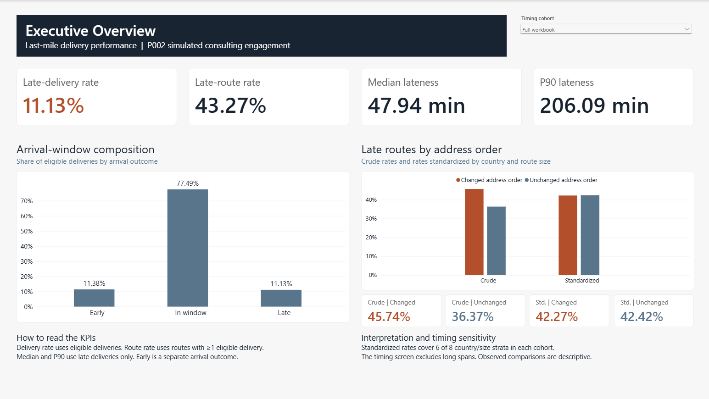

# Power BI companion report

**P002 · Self-directed, simulated consulting engagement**

The three-page Power BI Desktop report brings the approved PostgreSQL reporting layer into a dispatch review workflow. The model imports 12 bounded or aggregate CSV tables. It uses a shared timing-cohort dimension and keeps scoped percentiles, route rates, delivery rates, shortlists, and targeted investigations at their published grains.

## Power BI showcase

### Executive Overview

A Power BI Desktop capture of the executive page. The crude changed-minus-unchanged late-route gap is +9.37 percentage points. The standardized gap is −0.15 points across six supported country and route-size strata.

### Route Performance & Exceptions

Compares late-route rates by country, route size, and address order, alongside late-delivery rates by visit displacement. Each timing cohort has a bounded shortlist of 25 routes and a separate targeted investigation.

### Distance Deviations & Data Quality

Shows distance category counts, separate late-route and late-delivery rates, and published paired percentiles for the selected scope. The full workbook has 7,386 shorter, 5,291 equal, and 6,970 longer recorded routes. The median paired change is 0.00 geodesic km.

The Executive Overview is the only Power BI screenshot in this showcase. The other two pages are described above because the available captures show record-level details. The separate Streamlit reference dashboard has its own labeled screenshots. The Power BI project is machine-specific and is not offered as a downloadable PBIP. [Streamlit dashboard](../../README.md#dashboard) · [QA summary](QA.md) · [Reproduction guide](REPRODUCE.md)

## Methods and attribution

Late-delivery rates use eligible delivery visits. Late-route rates use routes with at least one eligible delivery. Standardization uses common country and route-size weights over supported strata. The timing sensitivity keeps spans of at most 1,440 minutes and may exclude legitimate long routes. Percentiles come from exact scope rows. The analysis describes one operator's observed workbook records. It cannot estimate a causal effect. Recorded Haversine leg totals describe geodesic distance. Road mileage, driving time, fuel use, and cost require separate measurements. [Dashboard contract](../../06_Dashboard/014_Dashboard_Data_Contract.md) · [Client findings](../../07_Reports_and_Delivery/020_Client_Findings_Report.md)

Dataset: Anna Konovalenko, Lars Magnus Hvattum, and Kim Aleksander Hammer Iversen (2024), *Last-mile delivery route deviations dataset: planned vs. actual routes*, Mendeley Data v1, DOI 10.17632/kkwgfvmtxn.1, CC BY 4.0. This project typed workbook values, applied eligibility and cohort filters, aggregated results, and presented them in dashboards. The existing repository MIT license covers original code and documentation. Underlying data retain their source license. [Versioned dataset](https://data.mendeley.com/datasets/kkwgfvmtxn/1) · [DOI](https://doi.org/10.17632/kkwgfvmtxn.1) · [CC BY 4.0](https://creativecommons.org/licenses/by/4.0/) · [P002 provenance](../../08_Documentation/Dataset_Provenance.md) · [MIT license](../../LICENSE)
