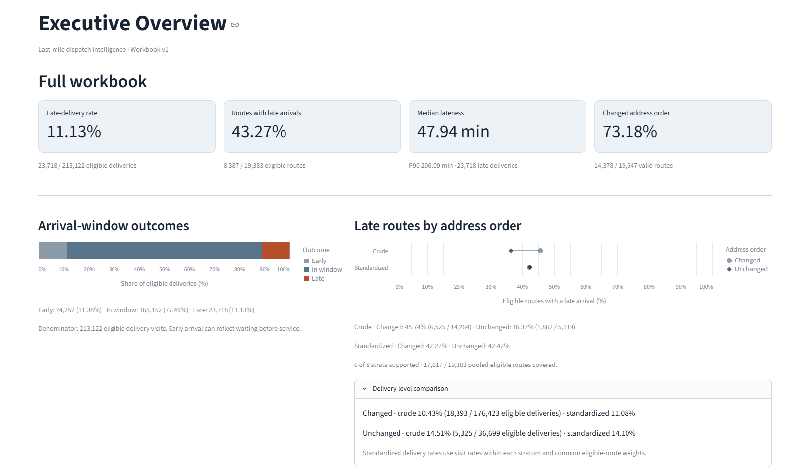
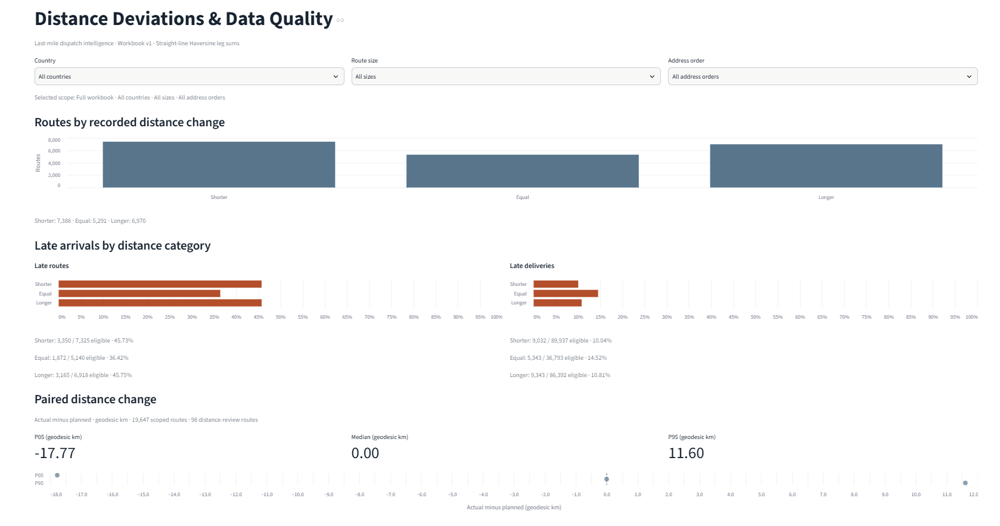

# Last-Mile Delivery Intelligence
### Turning Delivery Data into Better Dispatch Decisions

**Portfolio Project 002 | Logistics Analytics & Business Intelligence**

*Self-directed, simulated consulting engagement using a publicly available delivery operations dataset.*

**[View the Executive Case Study (PDF)](09_Portfolio_Publication/P002_Last_Mile_Delivery_Executive_Case_Study.pdf)**

## The Business Challenge

Late deliveries can frustrate customers, disrupt operations, and create uncertainty for dispatch managers.

But identifying which routes need attention isn't always straightforward. A route that appears inefficient may simply have more deliveries, tighter schedules, or different operating conditions.

**The objective:** Identify delivery performance issues, investigate the patterns behind them, and help dispatch teams make better-informed operational decisions.

## The Investigation

I analyzed **249,231 recorded visits across 19,647 delivery routes** in Norway and Denmark.

The investigation focused on three business questions:

1. How frequently are deliveries late, and how severe are those delays?
2. Are changes to delivery sequences associated with worse performance?
3. Which unusual route and timing records deserve further investigation?

I developed a repeatable reporting system and interactive dashboard to turn the underlying data into actionable business intelligence.

## What the Analysis Revealed

### 1. Late deliveries were a meaningful operational issue

**11.13% of eligible deliveries arrived late**, and 43.27% of routes with eligible deliveries experienced at least one late arrival.

Among late deliveries, the median delay was approximately 48 minutes. The 90th percentile was approximately 206 minutes.

**Why it matters:** Dispatch teams need visibility into both the frequency and severity of delays to prioritize investigations effectively.

### 2. An apparent routing problem was more complicated than it looked

Routes with changed delivery-address sequences initially appeared more likely to experience a late arrival.

- **Initial comparison:** 45.74% versus 36.37% of eligible routes had a late arrival.
- **After accounting for country and route size:** The difference narrowed to approximately zero across comparable groups.

The initial difference was largely explained by how the route groups were composed, rather than establishing that changing address order caused worse performance.

**Why it matters:** An operational decision based only on the initial comparison could target the wrong problem. Comparing similar routes provides a more defensible foundation for investigating performance.

### 3. Unusual route measurements revealed opportunities for further investigation

The analysis identified **98 routes with distance-related flags** requiring review.

These records were not automatically classified as inefficient or incorrect. Additional operational evidence would be needed to understand them.

**Why it matters:** Identifying suspicious patterns is valuable, but verifying their causes before changing operations is equally important.

## Recommended Business Actions

| Priority | Recommendation | Business purpose |
|---|---|---|
| 1 | Investigate severe late arrivals within comparable route groups | Focus attention on meaningful delivery exceptions |
| 2 | Validate unusual timing and distance records | Separate potential data issues from operational problems |
| 3 | Compare similar routes before changing dispatch policies | Avoid decisions based on misleading comparisons |
| 4 | Track exception causes and follow-up actions | Build stronger evidence for future improvements |

**Central takeaway:** Better operational decisions begin with identifying the right problems, testing initial assumptions, and separating meaningful findings from misleading patterns.

These recommendations are proposed next steps, not completed operational interventions.

## Interactive Dashboard

A three-page dashboard was developed to support ongoing delivery performance investigation.

### Executive Overview

Provides an overview of delivery punctuality, delay severity, and route-performance comparisons.

### Route Performance & Exceptions

Helps investigate route groups, delivery-sequence changes, and individual exceptions requiring attention.

### Distance Deviations & Data Quality

Highlights unusual route-distance patterns and records requiring additional validation.

**Dashboard documentation:** [User Guide](07_Reports_and_Delivery/020_Dashboard_User_Guide.md)

## Project Deliverables

This portfolio project demonstrates an end-to-end analytical engagement, from data preparation through reporting and recommendations.

- **Interactive Streamlit Dashboard:** Three pages supporting operational performance investigation.
- **Executive Summary:** Concise findings and recommended business priorities.
- **Client Findings Report:** Detailed analysis and supporting evidence.
- **PostgreSQL Reporting System:** Structured, repeatable data preparation and reporting.
- **Quality Assurance:** Documented tests, reconciliation checks, and analytical validation.
- **Power BI Companion:** An additional three-page reporting implementation using the same approved analytical outputs.

### View the Deliverables

- [Executive Summary](07_Reports_and_Delivery/020_Executive_Summary.md)
- [Client Findings Report](07_Reports_and_Delivery/020_Client_Findings_Report.md)
- [Dashboard User Guide](07_Reports_and_Delivery/020_Dashboard_User_Guide.md)
- [Power BI Showcase](09_Portfolio_Publication/power-bi/README.md)
- [Project Acceptance & Verification](07_Reports_and_Delivery/020_Delivery_and_Acceptance.md)

## Technical Documentation & Reproducibility

The project uses **PostgreSQL, SQL, Python, Streamlit, pandas, and Altair**, with a separate Power BI implementation.

The reporting workflow preserves source records, distinguishes delivery-level and route-level measures, and documents the definitions behind published findings.

The repository includes the following technical resources:

| Resource | Documentation |
|---|---|
| Database architecture and implementation | [PostgreSQL Implementation Plan](08_Documentation/PostgreSQL_Implementation_Plan.md) |
| Arrival performance definitions | [Arrival-Window KPIs](08_Documentation/PostgreSQL_Arrival_Window_KPIs.md) |
| Route comparisons and methodology | [Route Performance Analysis](08_Documentation/PostgreSQL_Route_Performance_Comparisons.md) |
| Data ingestion and verification | [Ingestion Runbook](08_Documentation/PostgreSQL_Ingestion_Runbook.md) |
| Analytical quality assurance | [Consolidated Technical QA](05_Quality_Assurance/013_Consolidated_Technical_QA.md) |
| Dashboard setup and execution | [Streamlit Runbook](06_Dashboard/015_Streamlit_Smoke_Runbook.md) |
| Dashboard validation | [Integrated Dashboard QA](06_Dashboard/019_Integrated_Dashboard_QA.md) |
| Power BI reproducibility | [Power BI Reproduction Guide](09_Portfolio_Publication/power-bi/REPRODUCE.md) |

### Reproducing the Project

The source workbook must be downloaded separately from [Mendeley Data](https://data.mendeley.com/datasets/kkwgfvmtxn/1).

To reproduce the analysis, follow the PostgreSQL provisioning and ingestion documentation, apply the reporting SQL migrations in the documented order, and use the Streamlit runbook to configure and launch the local dashboard.

The project README links to the detailed setup instructions rather than reproducing every terminal command.

The final project acceptance record reports **30 passing automated tests**, including live PostgreSQL checks. Keyboard accessibility and narrow-window testing remain open.

## Scope & Limitations

This project uses records from one delivery operator in Norway and Denmark. Its findings should not automatically be generalized to other businesses.

Important limitations include:

- Late-arrival measurements do not establish when deliveries were completed.
- Route comparisons describe associations, not proven causes.
- The adjusted route comparison covers approximately 91% of eligible routes; groups with insufficient comparison data were excluded.
- Recorded straight-line route distances are not equivalent to actual driving mileage.
- Operational cost savings, customer satisfaction improvements, and realized business outcomes were not measured.

**This is a simulated consulting engagement.** The analysis, dashboard, and recommendations are demonstrated project deliverables. No client implementation or resulting financial benefit is claimed.

## Data Source & Attribution

Konovalenko, A., Hvattum, L. M., and Iversen, K. A. H. (2024). *Last-mile delivery route deviations dataset: planned vs. actual routes.* Mendeley Data, Version 1.

- [Original Dataset](https://data.mendeley.com/datasets/kkwgfvmtxn/1)
- [DOI: 10.17632/kkwgfvmtxn.1](https://doi.org/10.17632/kkwgfvmtxn.1)
- [Dataset License: CC BY 4.0](https://creativecommons.org/licenses/by/4.0/)
- [Dataset Provenance](08_Documentation/Dataset_Provenance.md)

Original project code and documentation are released under the repository's [MIT License](LICENSE). The underlying dataset retains its CC BY 4.0 licensing.
