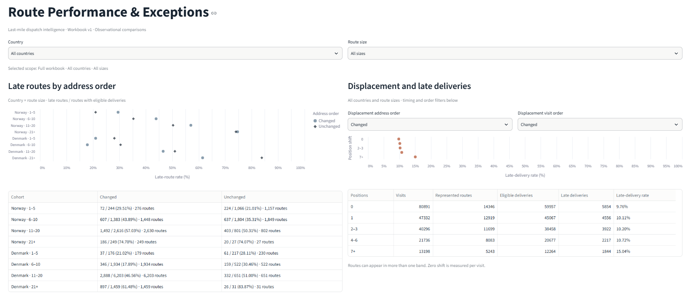

# Last-Mile Delivery Intelligence

**P002 · Self-directed, simulated consulting engagement**

How should a dispatch team prioritize late arrivals and route exceptions? This project turns a public last-mile delivery workbook into a reproducible PostgreSQL reporting layer and a three-page Streamlit dashboard. It examines arrivals, visit and address resequencing, and straight-line route distance across Norway and Denmark. The simulated team is the intended audience for the analysis.

[Executive summary](07_Reports_and_Delivery/020_Executive_Summary.md) · [Client findings](07_Reports_and_Delivery/020_Client_Findings_Report.md) · [Dashboard guide](07_Reports_and_Delivery/020_Dashboard_User_Guide.md) · [Acceptance evidence](07_Reports_and_Delivery/020_Delivery_and_Acceptance.md)

## Principal findings

| Verified measure | Result |
|---|---:|
| Source visits / routes | 249,231 / 19,647 |
| Late eligible deliveries | 23,718 / 213,122 (11.13%) |
| Routes with an eligible late arrival | 8,387 / 19,383 (43.27%) |
| Median / P90 lateness among late visits | 47.94 / 206.09 minutes |
| Routes with changed address order | 14,378 / 19,647 (73.18%) |
| Median paired straight-line distance change | 0.00 geodesic km |
| Shorter / equal / longer recorded routes | 7,386 / 5,291 / 6,970 |

Changed-address routes had a **+9.37 percentage-point** crude late-route gap versus unchanged-address routes. Applying common country and route-size weights across six supported strata reduced the gap to **−0.15 points**. After excluding routes with timing spans above 24 hours, the standardized gap was **+0.02 points**. The comparisons describe observed outcomes under those cohort definitions. [Methods and denominators](08_Documentation/PostgreSQL_Route_Performance_Comparisons.md)

## Architecture and methodology

**Mendeley XLSX → Python checksum and exact cell extraction → PostgreSQL staging and typed route/visit tables → authorized reporting views → local Streamlit dashboard.** The reference stack is PostgreSQL 18.6, Python 3.14, Psycopg 3.3.9, Streamlit 1.67.0, Altair and pandas on Ubuntu WSL2 ARM64.

- An import ID, worksheet and source row preserve workbook lineage. Planned and actual sequence keys preserve each visit even when stop or address codes repeat.
- Arrival KPIs count non-depot delivery visits with valid recorded windows. Route-level rates count a route once if it has at least one eligible late visit, using eligible routes as the denominator.
- SQL computes crude comparisons, common-weight standardization and a timing sensitivity cohort. Distance measures sum recorded Haversine legs. Quality flags retain unusual observations for review.
- Streamlit reads approved views as `p002_report` over loopback and binds locally. Filters and drill-through preserve route and visit grain. [Charter](00_Admin_and_Scope/Project_Charter.md) · [Schema and implementation](08_Documentation/PostgreSQL_Implementation_Plan.md) · [Dashboard contract](06_Dashboard/014_Dashboard_Data_Contract.md)

## Dashboard

The three screenshots in this section show the Streamlit reference dashboard.

| Page | What it answers |
|---|---|
| Executive Overview | How often were arrivals late, how severe were they, and how does the crude comparison change after weighting? |
| Route Performance & Exceptions | Which route cohorts and individual route exceptions warrant review? |
| Distance Deviations & Data Quality | What changed in recorded geodesic distance, and which anomalies need validation? |


Executive Overview. The full workbook shows 11.13% late eligible deliveries. The crude late-route gap narrows under common country and route-size weights.



Route Performance & Exceptions. Route-level and visit-level outcomes use separate denominators, with country, size, and displacement scopes labeled.


Distance Deviations & Data Quality. The median paired change is 0.00 geodesic km. Quality flags identify records for review.

## Power BI companion report

The three-page Power BI Desktop companion uses the same approved PostgreSQL outputs. Its 12-table semantic model keeps route and delivery denominators separate, selects published percentiles at one exact scope, and distinguishes bounded review lists from population summaries. The automation workflow validates CSVs, generates TMDL and PBIR definitions, checks schemas and analytical results, and uses a guarded Windows handoff with backup and rollback. The showcase includes a Power BI Executive Overview capture and describes the other two Power BI pages. The PBIP is machine-specific and is not included as a download. The interactive reproduction path below uses Streamlit. [Power BI showcase](09_Portfolio_Publication/power-bi/README.md) · [Power BI QA](09_Portfolio_Publication/power-bi/QA.md) · [Reproduction guide](09_Portfolio_Publication/power-bi/REPRODUCE.md)

## Run locally

Start from the repository root on Ubuntu WSL2 or a compatible Linux environment. The provisioning scripts assume an Ubuntu PostgreSQL installation and a local PostgreSQL administrator. Install PostgreSQL 18, Python 3.14 with `venv`, and system libpq. [PostgreSQL environment](08_Documentation/PostgreSQL_Environment_Assessment.md)

1. [Provision local roles and database](08_Documentation/PostgreSQL_Database_Provisioning.md). Apply [schema 007](08_Documentation/PostgreSQL_Relational_Schema.md) as `p002_dev`. Run each command block from your checkout root unless it says otherwise.
2. Download [Mendeley Data v1](https://data.mendeley.com/datasets/kkwgfvmtxn/1) separately. Create the local data folders and save the downloaded `routes_performance.xlsx` under `01_Data_Raw/` before running the extractor.

   ```bash
   mkdir -p 01_Data_Raw 02_Data_Processed
   python3 -B 04_Python/extract_routes_workbook.py \
     01_Data_Raw/routes_performance.xlsx 02_Data_Processed/task008_routes_staging.csv
   ```

   The extractor checks the workbook hash and refuses to overwrite an existing CSV. Follow the [ingestion runbook](08_Documentation/PostgreSQL_Ingestion_Runbook.md) for both checksums and the transactional load. Apply the reporting scripts 009, 010, 011, 012 and 014 in that order. [SQL order and roles](08_Documentation/PostgreSQL_Implementation_Plan.md) · [Dashboard SQL](06_Dashboard/014_Dashboard_Data_Contract.md)
3. Create the project environment and install the dashboard dependencies.

   ```bash
   python3 -m venv .venv
   .venv/bin/python -m pip install --only-binary=:all: -r 06_Dashboard/requirements-smoke.txt
   .venv/bin/python -m pip check
   ```

   Configure a private passfile for the read-only reporting login with mode `0600`. Follow the [credential setup](06_Dashboard/015_Streamlit_Smoke_Runbook.md#configure-the-local-reporting-credential).
4. From the repository root, launch the dashboard.

   ```bash
   cd 06_Dashboard
   env -u PGPASSWORD ../.venv/bin/python -m streamlit run dashboard.py \
     --server.address 127.0.0.1 --server.port 8501 --server.headless true \
     --theme.base light --theme.primaryColor '#58758C' --theme.textColor '#182431'
   ```

   Open `http://127.0.0.1:8501` in your local browser. Navigate with the sidebar and keep the database and app on loopback.

## QA and reproducibility

Run the default suite from the repository root:

```bash
.venv/bin/python -B -m unittest discover -s 05_Quality_Assurance/Tests -p 'test_*.py' -v
```

The final acceptance recorded **30 passing tests**, including four live PostgreSQL checks, on 20 November 2026. Task 013 consolidated analytical QA also passed in live WSL. All three pages received a browser walkthrough. Keyboard accessibility and narrow-window verification remain open. [Exact live QA commands](06_Dashboard/019_Integrated_Dashboard_QA.md) · [SQL QA and checksums](05_Quality_Assurance/013_Consolidated_Technical_QA.md) · [Acceptance record](07_Reports_and_Delivery/020_Delivery_and_Acceptance.md)

## Limitations and future work

The workbook describes one operator and uses route-relative arrival offsets. It cannot establish service completion or a causal effect of resequencing. Straight-line Haversine totals describe recorded geometry. Road mileage, fuel, driving time and costs require separate measurements. Standardization covers supported strata, and the published descriptor's route count remains 150 below the audited workbook count. Future work could validate timing flags with the data owner, capture service-start and exception data, complete keyboard and responsive testing, and record a transitive dependency lock. [Findings and limits](07_Reports_and_Delivery/020_Client_Findings_Report.md)

## Dataset attribution

Anna Konovalenko, Lars Magnus Hvattum, and Kim Aleksander Hammer Iversen (2024), *Last-mile delivery route deviations dataset: planned vs. actual routes*, Mendeley Data v1, DOI 10.17632/kkwgfvmtxn.1, CC BY 4.0. This project extracts and types source values, computes route and visit metrics, and applies eligibility, aggregation, and cohort weighting. [Dataset](https://data.mendeley.com/datasets/kkwgfvmtxn/1) · [DOI](https://doi.org/10.17632/kkwgfvmtxn.1) · [CC BY 4.0](https://creativecommons.org/licenses/by/4.0/) · [Provenance](08_Documentation/Dataset_Provenance.md)

## Repository license

The [MIT license](LICENSE) covers original project code and documentation. The Mendeley workbook and its underlying data remain covered by [CC BY 4.0](https://creativecommons.org/licenses/by/4.0/).
